<a href="https://pavan-mallesh-portfolio.vercel.app/">
  
</a>

  &nbsp;
  &nbsp;
  &nbsp;
  

<h2></h2>


<h2></h2>


<h2></h2>

<a href="https://github.com/pavan4466/smartphone-market-data-analysis">
  
</a>

<a href="https://github.com/pavan4466/smartphone-market-data-analysis">Repository / Smartphone Market Analysis ↗</a>

<a href="https://github.com/pavan4466/movie-sales-analysis-dashboard">
  
</a>

<a href="https://github.com/pavan4466/movie-sales-analysis-dashboard">Repository / Movie Sales Dashboard ↗</a>

<a href="https://github.com/pavan4466/World-Wide-Energy-Consumption-Analysis-SQL">
  
</a>

<a href="https://github.com/pavan4466/World-Wide-Energy-Consumption-Analysis-SQL">Repository / World Energy Consumption ↗</a>


<h2></h2>


<h2></h2>


<h2></h2>


<h2></h2>


  &nbsp;
  &nbsp;
  &nbsp;
  


Text version of this profile

### Vinjamuri Pavan Mallesh

Data Analyst · Hyderabad, India

I clean, query, and visualize data so teams can decide with evidence.

**Education:** B.Tech CSE (Data Science), St. Ann's College of Engineering and Technology, 2026 · CGPA 8.2/10

**Experience**

- **Campus Mantri**, GeeksforGeeks — Jan 2026 to present. Campus outreach, events, and peer engagement. Letter of Recommendation.
- **Data Analytics Intern (Virtual)**, SmartBridge Educational Services — Dec 2025 to Mar 2026. Cleaned and transformed structured data with SQL, Excel, and Tableau. Built 3+ KPI dashboards and analyzed 1,000+ UNESCO records.
- **Intern**, AIMERS — May to Jul 2024. Preprocessed and validated datasets with Python and OpenCV. Supported model testing and dataset quality checks.

**Selected projects**

- [Smartphone Market Analysis](https://github.com/pavan4466/smartphone-market-data-analysis) — 400+ Flipkart listings; RAM and storage explain about 60% of price variance. Python, pandas, BeautifulSoup.
- [Movie Sales Dashboard](https://github.com/pavan4466/movie-sales-analysis-dashboard) — genre leaders across revenue, ratings, and votes. Power BI, Power Query, DAX.
- [World Energy Consumption Analysis](https://github.com/pavan4466/World-Wide-Energy-Consumption-Analysis-SQL) — country-level SQL analysis across energy, emissions, GDP, and population. MySQL.
- **RetailPulse Analytics** — end-to-end sales and inventory case study. In build.

**Contact:** [pavanvinjamuri17@gmail.com](mailto:pavanvinjamuri17@gmail.com) · [LinkedIn](https://www.linkedin.com/in/pavanmallesh4466/) · [GitHub](https://github.com/pavan4466) · [Portfolio](https://pavan-mallesh-portfolio.vercel.app/)

